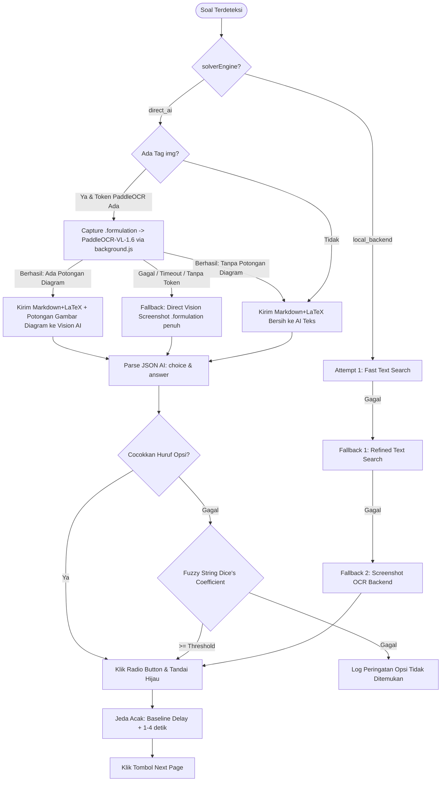

# System & Architecture Context (`context.md`)

Dokumen ini berisi konteks teknis, arsitektur sistem, skema penyimpanan data, pemetaan selector DOM, dan detail protokol integrasi proyek **Mylms Extension (Kamus Mini)**. Dokumen ini ditujukan sebagai referensi cepat bagi AI Assistant dan Developer.

---

## 1. Ringkasan & Persona Sistem

- **Nama Ekstensi:** Kamus Mini (*Stealth facade name*)
- **Target Platform:** Moodle LMS Quiz Module (`/mod/quiz/attempt.php`, dsb.) serta platform CBT/E-learning sejenis.
- **Teknologi Ekstensi:** Chrome Extensions Manifest V3, Pure Vanilla JavaScript, KaTeX offline engine.
- **Dua Mesin Solver (Dual-Engine):**
  1. **Direct AI Cloud (Default):** Google Gemini API (`v1beta`), Groq Cloud API, OpenAI API.
  2. **Local Backend (Legacy):** Server bank soal lokal di port 3000 / 5000 (`openapi.json`).

---

## 2. Pemetaan Selector DOM Moodle LMS

| Komponen | Selector CSS | Keterangan / Fungsi |
| :--- | :--- | :--- |
| **Kontainer Soal** | `.formulation` | Area utama yang membungkus teks soal dan seluruh pilihan. Target crop screenshot canvas. |
| **Induk Soal** | `.que` | Kontainer luar per butir soal Moodle. |
| **Nomor Soal** | `.que .info .qno`, `.qno` | Menampilkan nomor urut soal aktif (misal: "1", "2"). |
| **Teks Soal** | `.qtext` | Area teks deskripsi pertanyaan. |
| **Pilihan Jawaban** | `.answer > div` | Elemen baris per opsi pilihan ganda. |
| **Label Opsi** | `.answernumber` | Huruf penanda pilihan (misal: "a.", "b.", "c."). |
| **Teks Opsi** | `.flex-fill`, `label` | Teks isi pilihan jawaban. |
| **Radio Button** | `input[type="radio"]` | Input pilihan untuk disimulasikan kliknya saat jawaban cocok. |
| **Deteksi Gambar/Rumus** | `.qtext img`, `.answer img` | Menentukan apakah mode Vision/Math Mode harus langsung dipicu. |
| **Tombol Halaman Selanjutnya** | `input[value*="Next"]`, `button[id*="next"]`, `.btn[value*="Next"]`, dll. | Tombol navigasi ke soal/halaman berikutnya. Diinspeksi juga via teks: "Next page", "Selanjutnya", "Halaman berikutnya". |
| **Tombol Selesai** | Tombol bertuliskan "Finish attempt" atau "Selesaikan kuis" | Deteksi halaman akhir untuk memicu *Auto-Submit Guard*. |
| **Cloudflare Captcha** | `.cf-turnstile`, `iframe[src*="challenges.cloudflare.com"]`, `#challenge-form` | Elemen indikasi tantangan Captcha aktif. |

---

## 3. Skema Penyimpanan (`chrome.storage.local`)

```typescript
interface ExtensionStorage {
  // Pilihan Mesin
  solverEngine: 'direct_ai' | 'local_backend'; // Default: 'direct_ai'

  // Konfigurasi Direct AI
  aiProvider: 'gemini' | 'groq' | 'openai' | 'custom'; // Default: 'gemini'
  aiApiKey: string;                             // API Key AI pengguna (opsional jika local Ollama/LM Studio)
  aiModel: string;                              // Misal: 'gemini-1.5-flash', 'llama-3.3-70b-versatile', 'deepseek-chat'
  aiCustomBaseUrl?: string;                     // Misal: 'https://api.deepseek.com/v1', 'https://openrouter.ai/api/v1', 'http://localhost:11434/v1'
  aiCustomModel?: string;                       // ID Model kustom misal: 'deepseek-chat', 'deepseek-reasoner', 'llama3.2'

  // Konfigurasi OCR Pintar (PaddleOCR-VL-1.6)
  ocrEnabled?: boolean;                         // Default: true (aktif otomatis bila paddleOcrToken diisi)
  paddleOcrToken?: string;                      // Access Token Baidu AI Studio (https://aistudio.baidu.com/account/accessToken)
  paddleOcrModel?: string;                      // Default: 'PaddleOCR-VL-1.6'
  paddleOcrJobUrl?: string;                     // Opsional override endpoint (default: https://paddleocr.aistudio-app.com/api/v2/ocr/jobs)

  // Konfigurasi Backend Lokal (Legacy)
  baseUrl: string;                              // Default: "http://localhost:3000"
  apiKey: string;                               // Token x-api-key backend lokal

  // Perilaku & Navigasi Agen
  navigationMode: 'semi_auto' | 'full_auto';    // Default: 'semi_auto' (Auto-Solve, Manual Next)
  baselineDelay: number;                        // Jeda dasar sebelum next page pada Full-Auto (detik, default: 3)
  matchThreshold: number;                       // Ambang batas kemiripan (default: 0.70 - 0.75)

  // Status AI Agent
  agentState: {
    status: 'idle' | 'running' | 'paused-by-captcha' | 'completed';
    lastUrl?: string;
    timestamp?: number;
  };

  // Log Aktivitas
  agentLogs: string[];                          // Array string log aktivitas terbaru (maksimal 100 entri)
}
```

---

## 4. Alur Kerja Dual-Engine Solver (`content.js`)



---

## 5. Antarmuka Pengguna & Navigasi

1. **Popup Minimalis (`popup.html` & `popup.js`):**
   - Berfungsi sebagai pengendali instan (HUD / remote control).
   - Menampilkan status agen, tombol **Start**, **Stop**, konsol log ringkas beserta tombol **📋 Lengkap** (membuka `logs.html`), **📄 Salin** (menyalin laporan diagnostik lengkap ke clipboard), serta tombol roda gigi (⚙️).
   - Tombol ⚙️ memicu `chrome.runtime.openOptionsPage()` yang membuka `options.html` di tab baru.
2. **Halaman Pengaturan Mandiri (`options.html` & `options.js`):**
   - Didaftarkan melalui `"options_ui": { "page": "options.html", "open_in_tab": true }`.
   - Mengatur semua preferensi: pergantian engine (Direct AI vs Local Backend), pemilihan model, pengujian koneksi API (`⚡ Tes Koneksi AI`), serta konfigurasi jeda delay dan threshold.
3. **Diagnostic Logs & Screenshot Inspector (`logs.html` & `logs.js`):**
   - Menampilkan pratinjau PNG terakhir yang benar-benar dikirim ke Vision AI (`lastCapturedDebug`) beserta dimensi, ukuran KB, jumlah slice, jumlah piksel non-putih (deteksi putih polos), serta overlay yang disembunyikan.
   - Menampilkan timeline terstruktur (`agentDebugLogs`, hingga 200 entri via antrean tulis terseri `enqueueStorageLogUpdate` tanpa race condition) dengan filter kategori dan ekspor `.txt` / salin laporan.

---

## 6. Dukungan Arsitektur SPA & ReplayWeb.page (`.wacz`)

- **Penetrasi Shadow DOM, Iframe, & Kendali Top-Frame (`getQuizDocument()` & `isManagedByTopFrame()`):**
  Pada aplikasi berbasis SPA atau arsip WebRecorder/ReplayWeb.page (`<replay-web-page>`), elemen kuis berada di dalam `shadowRoot` dan inner `<iframe>`. Fungsi rekursif `findQuizContextInRoot()` / `getQuizDocument()` memindai `document`, `replay-web-page.shadowRoot`, serta iframe same-origin secara penuh beserta rantai offset `<iframe>`-nya. Karena `"all_frames": true`, fungsi `isManagedByTopFrame()` memastikan frame anak same-origin menyerahkan eksekusi sepenuhnya ke top frame agar offset iframe terhadap viewport selalu akurat dan tidak terjadi eksekusi ganda.
- **Deteksi Soal Baru Tanpa Reload (Zero-Reload / Heartbeat Poller):**
  Perpindahan halaman pada SPA tidak memicu event reload dokumen biasa. Sistem menggunakan:
  1. **Heartbeat Poller (700ms):** Membandingkan `currentKey = "${qNum}::${qText.slice(0, 80)}"` dengan `lastSolvedQuestionKey`. Jika berbeda saat agen berstatus `running`, fungsi langsung menjawab soal baru.
  2. **SPA Navigation Listeners:** Mendengarkan event `hashchange` dan `popstate`.
  3. **Tombol Sniffer:** Menangkap klik manual pada tombol "Halaman selanjutnya" untuk memantau render soal berikutnya.
- **Pencegahan Bias Nama Berkas (`scrapeOptionsText()`):**
  Pada soal gambar ExamView (`mc025-8.jpg`, dll.), `scrapeOptionsText()` menyaring atribut `alt` yang merupakan nama berkas gambar mentah sehingga prompt Vision AI hanya menampilkan placeholder netral (`[Lihat nilai pilihan A pada gambar]`) agar AI membaca nilai asli dari gambar.
- **Tangkapan Layar Full-Resolution Sticky-Free Scroll-and-Stitch (`captureFormulationElement()`):**
  Alih-alih mengecilkan skala dengan `transform: scale()` (yang menggeser soal ke bawah header lengket/sticky dan memburamkan opsi berukuran kecil), ekstensi menggunakan teknik **Sticky-Free Scroll-and-Stitch** berbasis native `captureVisibleTab`:
  1. Mendeteksi kontainer scroll sebenarnya melalui `getScrollContainer()` (`isScrollableNode()`).
  2. Menghitung batas viewport iframe sebenarnya dalam koordinat window utama via `computeFrameViewportBounds()`.
  3. Menyembunyikan sementara header/navbar/drawer bertipe `fixed`/`sticky` (termasuk `#topBarContainer` Moodle Space theme) dan toast `#g-dict-tooltip` lewat `hideObstructingOverlays()` (memindai selector umum serta sapuan geometris `elementsFromPoint()` dengan `transition: none !important`), lalu memulihkannya di blok `finally`.
  4. Menggulirkan dan menjahit potongan `.formulation` pada resolusi layar penuh (DPR hingga 2x) dengan penjaga batas kuota `captureVisibleTab` (>= 580ms antar-potongan bila tinggi elemen melebihi sisa viewport).
